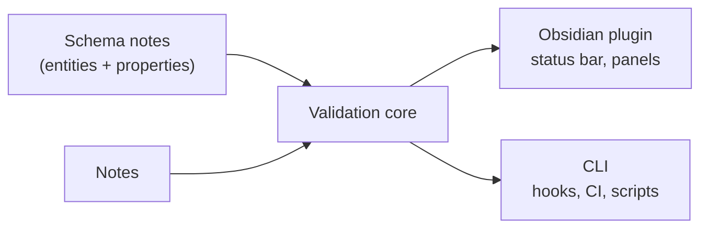
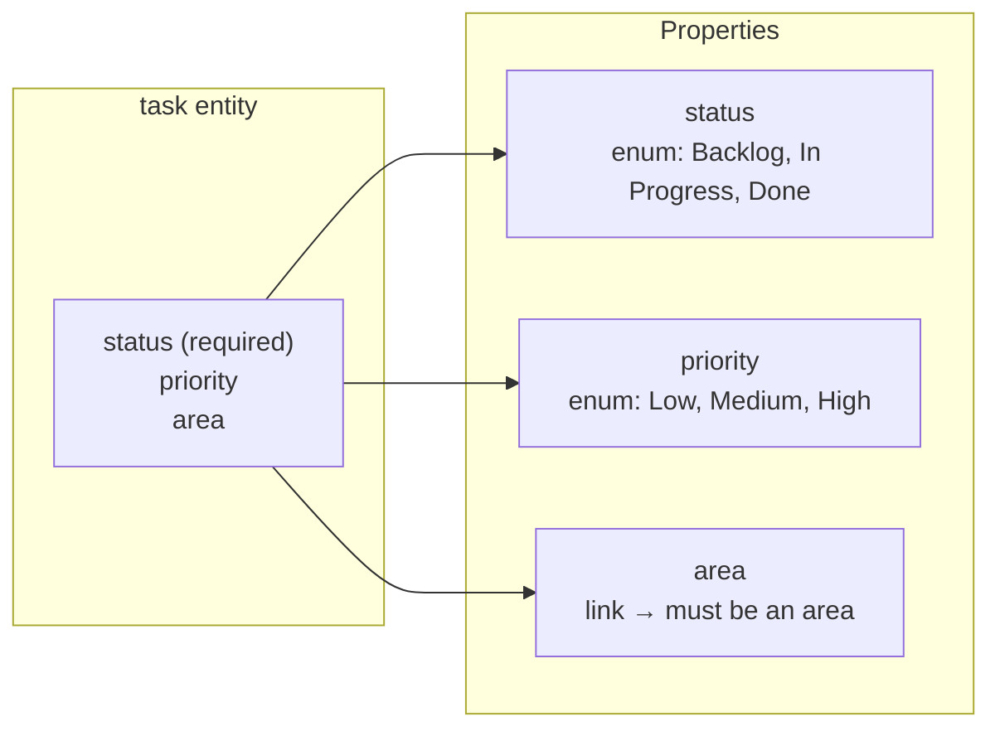
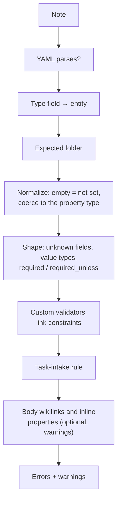
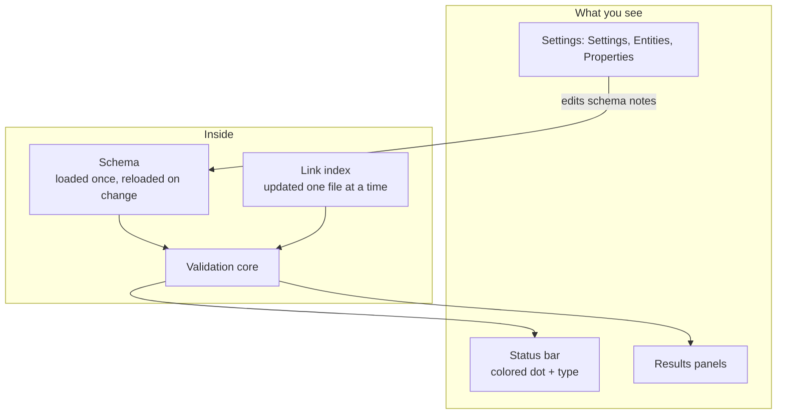

# Architecture

> For user-facing docs, see [Getting started](getting-started.md).

## Core idea

A vault holds two things: the **schema** (how notes should look) and the **notes**. The schema
is loaded once, then every note is checked against it. Two front ends share one validation core:
the Obsidian plugin and the `obsi-validate` CLI.

---

## Entities and properties

**Entities** say which fields a note type has; **properties** say what a valid value is.
Entities refer to properties by name and properties know nothing about entities, so one
property (e.g. `status`) is reused by many entity types.

Entities can `extend` other entities; inheritance is resolved when the schema loads.

---

## How a note is validated

The **shape** step is a pluggable engine: Zod (validators built from the property notes) or
mdbase (JSON Schema generated from the same notes; see [mdbase engine](mdbase.md)). Both get
the same normalized values and give the same verdicts and messages; the plugin uses Zod and the
CLI uses mdbase by default. Every other step is shared code and runs the same way under both.

---

## Modules

| Module | Role |
|--------|------|
| `schema.ts` | Parse entity and property notes, resolve inheritance, build Zod validators, compile custom validators, pick the type field |
| `validate.ts` | Validate one note (the order above), body links, inline properties |
| `rules/task-intake.ts` | The task-intake rule |
| `link-index.ts` | Wikilink parsing, the link index and link resolution |
| `vault-files.ts` | Which files are validated (incl. template folders), linked to, or loaded as schema |
| `frontmatter.ts` | Frontmatter parsing and the frontmatter/body boundary |
| `values.ts` | Empty values, coercion, messages, field labels |
| `mdbase/` | Schema → JSON Schema (`translate.ts`), the mdbase engine (`adapter.ts`), `mdbase-export` (`export.ts`) |
| `index.ts` | Library entry point |
| `cli.ts`, `config.ts`, `walk.ts` | CLI: options and config file, folder walks |
| `plugin-main.ts`, `bridge.ts` | Plugin: lifecycle and events; vault access, link-index cache, schema writes |
| `plugin-settings.ts`, `SettingsTab.ts`, `ui/` | Plugin settings and the schema editor |
| `ResultsView.ts`, `VaultResultsView.ts`, `view-lookup.ts` | Result panels |
| `vault-path.ts` | Keeps schema writes inside the vault |

The core (`schema`, `validate`, `rules`, `link-index`, `vault-files`, `frontmatter`, `values`,
`mdbase/translate`, `mdbase/adapter`) takes file contents, not paths, and never touches the
file system; the plugin and the CLI only differ in how they read files.

---

## Plugin

- Editing a note revalidates it 800 ms after the last change; switching notes validates the
  new one.
- A change under `entities/` or `properties/` reloads the schema.
- The link index is built on first use and then updated per created, changed, renamed or
  deleted file.
- The settings UI edits schema notes in place (`processFrontMatter`): only the keys it shows
  change.

## CLI

- Options, environment, the vault found above the path, then the config file (`config.ts`).
- Notes are read one at a time; without `--check-links` only the frontmatter block is parsed.
- With `--check-links` the whole vault is indexed first (every file outside dot-folders and
  excluded folders) so links from the target to notes elsewhere resolve.
- mdbase is loaded only when used, and only its JSON-Schema validator, not the whole library.

---

## Security

!!! warning
    Custom validators are unsandboxed JavaScript. Only use expressions you wrote or trust.

**Custom validators** (`custom_validator`) are compiled with `new Function` and run with full
access to the JavaScript environment: `window` and `app` in Obsidian, `process` and Bun APIs in
the CLI. They are as trusted as any code in your vault.

**File access**: the plugin reads through Obsidian's Vault API and writes only schema notes —
under `{schema_dir}/entities/` and `{schema_dir}/properties/` — refusing absolute paths and `..`.
Archive moves a note into `_deprecated/`; nothing is deleted. The CLI only reads.

---

## Dependencies

| Package | Purpose |
|---------|---------|
| `gray-matter` | Frontmatter parsing |
| `zod` | Value checks (plugin, `--engine zod`, inline properties) |
| `@callumalpass/mdbase` | JSON-Schema engine (CLI default; not in the plugin bundle) |
| `commander` | CLI options (not in the plugin bundle) |
| `obsidian` | Plugin API (provided by Obsidian) |
| Bun, `esbuild`, TypeScript | Runtime and build tools |
