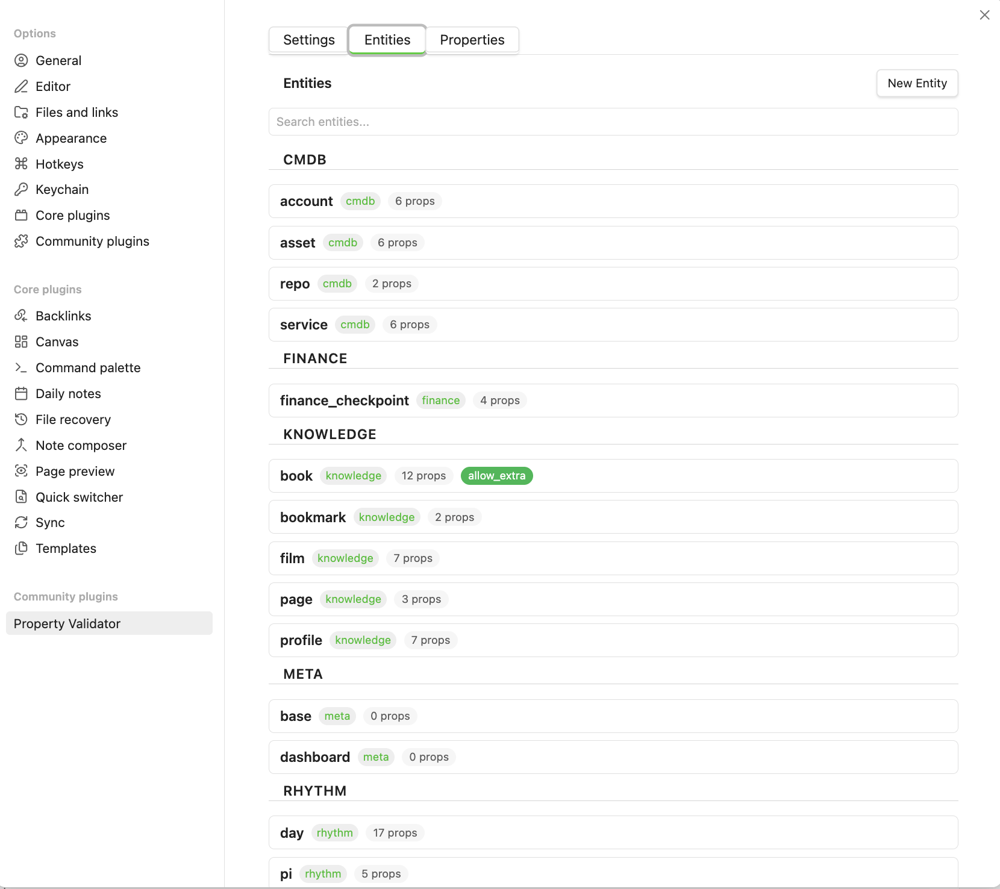
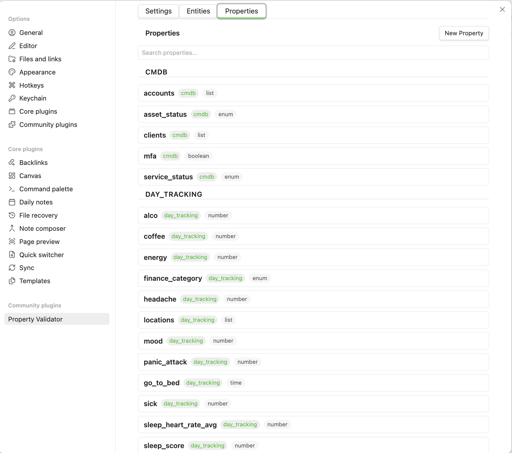
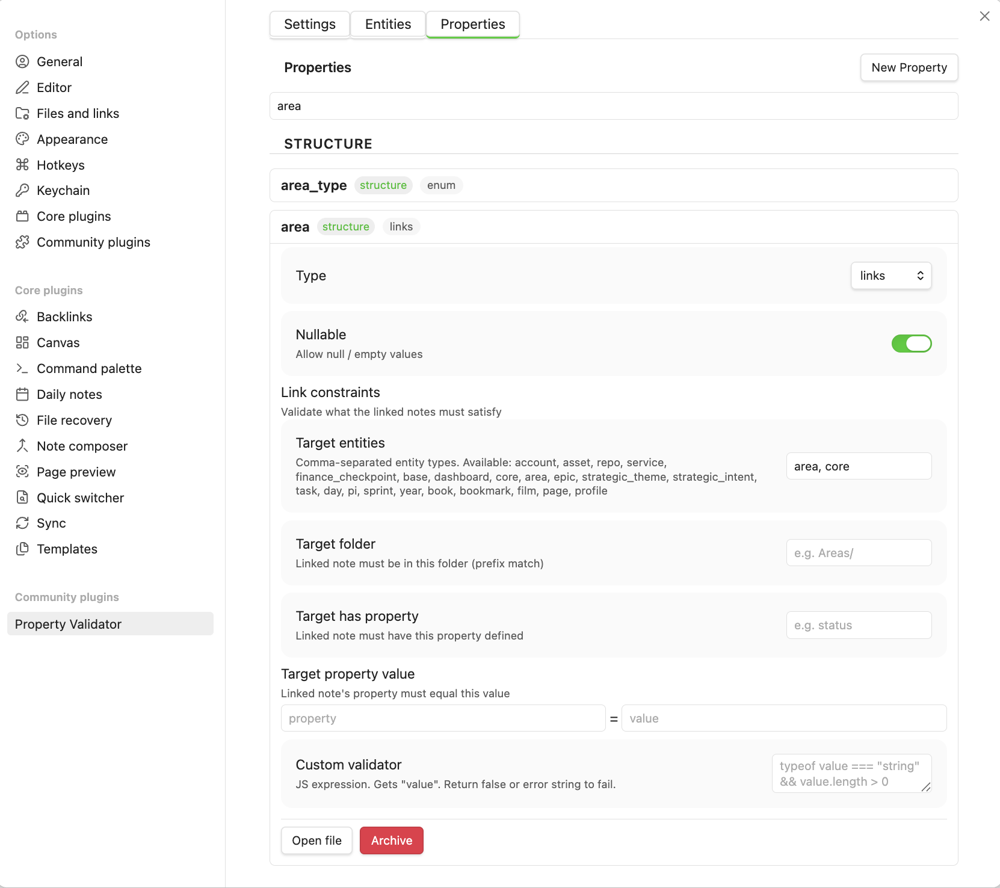

# Configuration

All settings are in **Settings > Property Validator**, on three tabs: Settings, Entities,
Properties.

---

## Settings

| Setting | Default | Description |
|---------|---------|-------------|
| **Schema directory** | `.` | Folder with `entities/` and `properties/`, relative to the vault root. |
| **Type key field** | *(empty)* | Frontmatter field naming a note's type. Empty: `type_key` if the schema declares a `type_key` property, else `entity` — the same rule as the CLI. |
| **Default entity type** | *(empty)* | Type for notes without a type field. Such notes are validated as that type, with a warning. Empty: they are skipped. |
| **Check links in the note body** | on | Report, as warnings, body wikilinks and inline `[key:: value]` properties that point to missing notes or break a property rule, like the CLI's `--check-links`. |
| **Show ribbon icon** | off | A "Validate vault" button in the left sidebar. |

!!! tip
    Keep the schema in its own folder, e.g. `_system`.

!!! note "What is never validated"
    The plugin and the CLI skip the same notes: anything under a dot-folder, `_archive/`,
    `_skill/` or the template folder (set in the core Templates or the Templater plugin), and
    `_index.md` files. Archived notes are still link targets by full path, but
    never win a bare name over a live note. Schema loading also skips `_deprecated/`.

The CLI's `exclude_dirs` / `--exclude` have no plugin setting.

---

## Commands

| Command | Description |
|---------|-------------|
| **Validate current file** | Validate the active note and open the results panel |
| **Validate vault** | Validate every note and open the vault results panel |
| **Show validation results** | Open the results panel for the active note |

All are in the Command Palette (`Cmd/Ctrl + P`).

---

## Status bar

A colored dot for the active note:

- :green_circle: **Green** — valid
- :yellow_circle: **Yellow** — warnings only
- :red_circle: **Red** — errors

Click it to open the results panel. It is hidden when the note has no type, and also when its
YAML does not parse or its type field is not text — run **Validate current file** to see why.

---

## Automatic validation

- After an edit is saved (800 ms after the last change)
- When you switch notes
- The schema reloads when a file under `entities/` or `properties/` changes; the link index
  follows created, changed, renamed and deleted files.

---

## Managing schemas

Schema notes are ordinary markdown. Saving from the UI edits only the frontmatter keys the form
shows and keeps everything else: the note body, keys the form does not show (`etl`,
descriptions) and per-property rules such as `required_unless`.

### Entities tab

Entities are grouped by subfolder. Expand one to edit:

- **Extends** — the parent entity
- **Allow extra fields** — no warnings for unlisted fields
- **Expected folder** — notes of this type must live in this folder
- **Own properties** — with a required toggle each; add from the list or type a new name
- **Inherited properties** — read-only, grouped by the entity they come from
- **Open file** / **Archive**

#### Creating an entity

Click **New Entity**, fill in the form and click **Create**. Names are lower-cased with spaces
turned into `_`; they may not contain `/ \ : * ? " < > |`, start with `.` or `_`, or be longer
than 100 characters. The note is created as `entities/<name>_entity.md`, along with the folders.

Edits save automatically, 500 ms after the last change. To change an inherited property's rule,
add it to the child's own list. Full format: [Schema reference > Entity files](schema-reference.md#entity-files).

---

### Properties tab

Properties are grouped by subfolder. Expand one to edit:

- **Type** and the fields for that type
- **Nullable** — an empty value counts as filled in, for a required field
- **Custom validator** — a broken expression is not saved
- **Open file** / **Archive**

#### Creating a property

Click **New Property**, fill in the form and click **Create**. Extra fields by type:

| Type | Fields |
|------|--------|
| `enum` | Allowed values |
| `number` | Min value, Max value, Unit |
| `link`, `links`, `list` | Link constraints (below) |

**Nullable** is set when editing an existing property. Full format:
[Schema reference > Property files](schema-reference.md#property-files).

#### Link constraints

- **Target entities** — allowed types of the linked note
- **Target folder** — the linked note's path must start with this folder
- **Target has property** — the linked note must have this field
- **Target property value** — the linked note's field must equal this value

---

### Search

Both tabs have a search field that filters by name, ignoring case.

### Archiving

**Archive** moves the note into a `_deprecated/` folder next to it. Archived definitions are
not part of the schema, so notes of an archived type fail with `Unknown entity type`. Nothing
is deleted.
