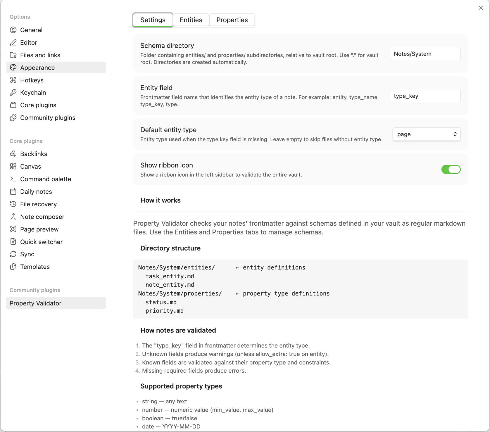
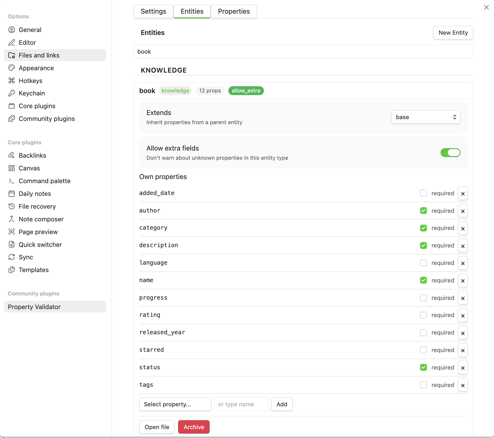
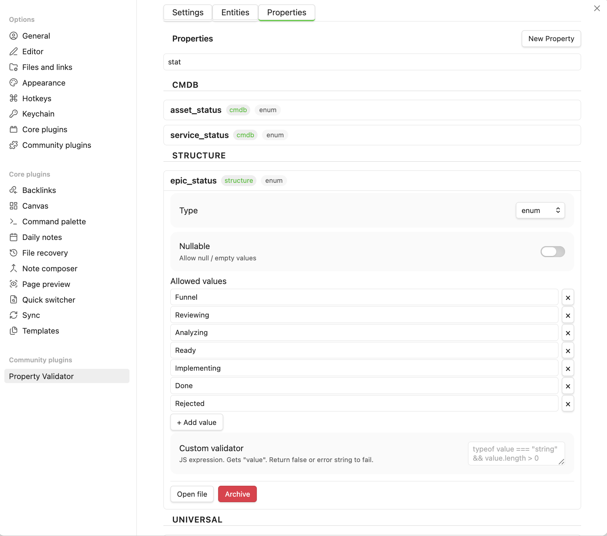
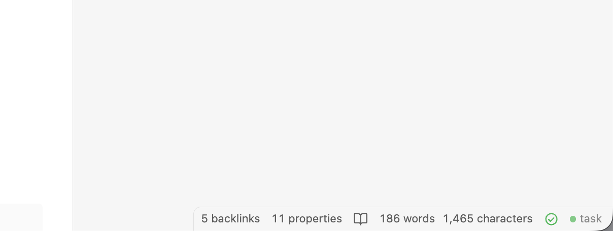
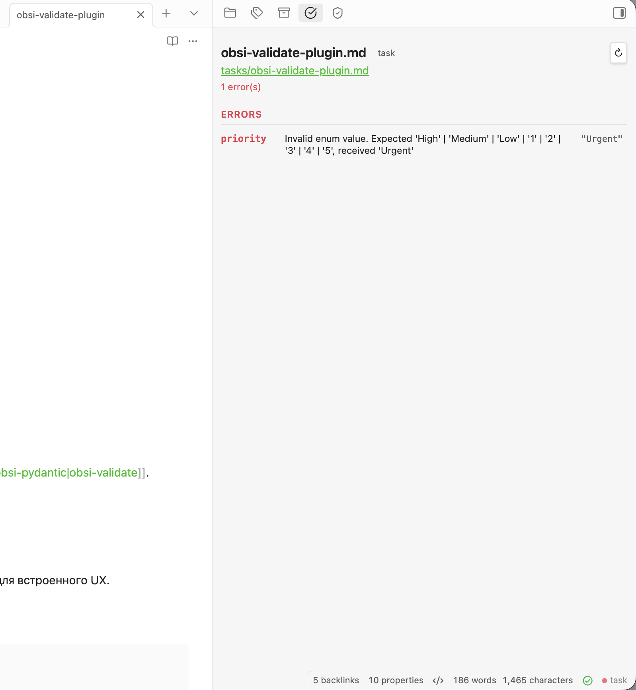
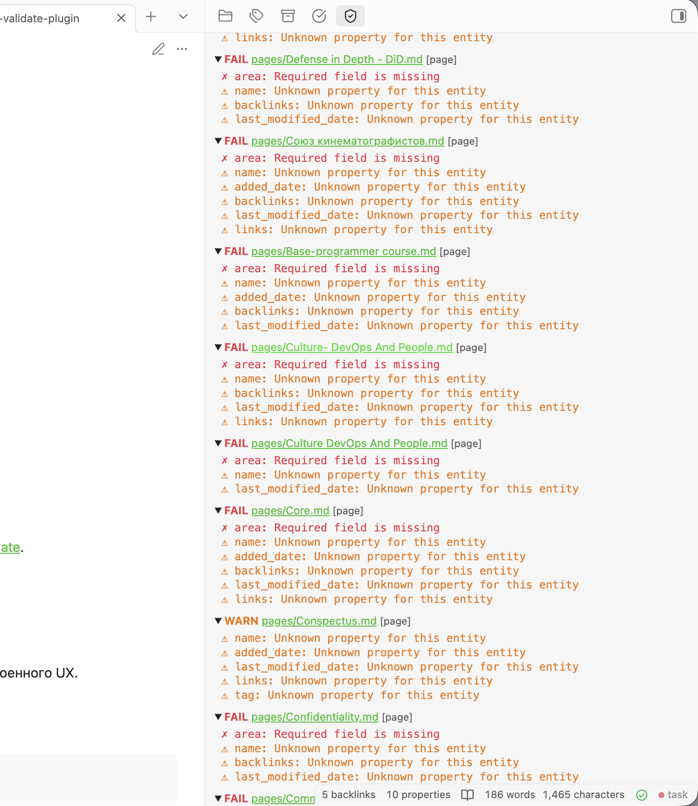

# Getting started

## Installation

Requires [Bun](https://bun.sh) 1.3 or later and Node.js 20 or later (for the plugin build).

1. Build the plugin:

    ```bash
    git clone https://github.com/mishachepi/obsi-validate.git && cd obsi-validate
    bun install && bun run build
    ```

2. Copy it into your vault:

    ```bash
    mkdir -p /path/to/vault/.obsidian/plugins/property-validator
    cp main.js manifest.json styles.css \
       /path/to/vault/.obsidian/plugins/property-validator/
    ```

3. Enable it in Obsidian: **Settings > Community plugins > Property Validator**.

For the command-line tool see [CLI](cli.md#installation).

### Keeping a source install up to date

To run the plugin and the CLI straight from a clone, link the plugin files instead of copying
them; then updating is one script. It is safe to run again on any machine:

```bash
set -euo pipefail
REPO="${REPO:-$HOME/obsi-validate}"     # where the clone lives
VAULT="${VAULT:?set VAULT to your vault folder}"

[ -d "$REPO/.git" ] || git clone https://github.com/mishachepi/obsi-validate.git "$REPO"
git -C "$REPO" pull --ff-only
cd "$REPO" && bun install --frozen-lockfile && bun test && bun run build && bun run build:cli
bun link >/dev/null                      # obsi-validate → $REPO/dist/cli.js

P="$VAULT/.obsidian/plugins/property-validator"; mkdir -p "$P"
for f in main.js manifest.json styles.css; do ln -sfn "$REPO/$f" "$P/$f"; done

obsi-validate --help > /dev/null && echo "obsi-validate $(git -C "$REPO" rev-parse --short HEAD) installed"
```

Then reload the plugin in Obsidian (toggle it off and on under **Community plugins**): Obsidian
keeps the old `main.js` until then.

---

## Quick start

Create a schema and validate a note in 5 minutes.

### 1. Set the schema directory

Go to **Settings > Property Validator > Settings** and set the **Schema directory** (e.g. `System`). The `entities/` and `properties/` folders are created with your first entity and property.



---

### 2. Create an entity

!!! info "What is an entity?"
    An entity is a **note type** — like `task`, `book`, or `person`. It declares which frontmatter fields the note should have.

Open the **Entities** tab, click **New Entity**, fill in the form and click **Create**.

- **Name**: `task`
- **Properties**: add `status` (required) and `priority` (optional)



This creates `System/entities/task_entity.md`:

```yaml
---
entity_name: task
properties:
  status:
    required: true
  priority: {}
---
```

See [Schema reference > Entity files](schema-reference.md#entity-files) for all available fields.

---

### 3. Create properties

!!! info "What is a property?"
    A property is a **validation rule** for a field — it defines what values are allowed.

Open the **Properties** tab and create two properties (**New Property**, then **Create**):

**Status** — an enum with allowed values:

- **Name**: `status`
- **Type**: `enum`
- **Allowed values**: `Backlog`, `In Progress`, `Done`

```yaml
---
property_name: status
property_type: enum
allowed_values:
  - Backlog
  - In Progress
  - Done
---
```

**Priority** — another enum:

- **Name**: `priority`
- **Type**: `enum`
- **Allowed values**: `Low`, `Medium`, `High`

```yaml
---
property_name: priority
property_type: enum
allowed_values:
  - Low
  - Medium
  - High
---
```



See [Schema reference > Property files](schema-reference.md#property-files) for all available fields and types.

---

### 4. Validate a note

Open any note and add frontmatter:

```yaml
---
entity: task
status: In Progress
priority: High
---
# My first task

This note is now validated against the task schema.
```

!!! note
    The `entity` field tells the plugin which entity the note is. If your schema declares a
    `type_key` property, notes use `type_key:` instead; any other name can be set as
    **Type key field** in [Configuration](configuration.md).

The status bar shows a green dot — the note is valid.



---

### 5. See validation in action

Change `status` to `Urgent`. The status bar turns red; click it to open the results panel,
which shows the field and the message:

```
status   "Urgent" is not an allowed value. Allowed: Backlog, In Progress, Done
```



Clear the value of `status`, or remove the field. Since it's required, you get:

```
✗ status: Required field is missing
```

---

### 6. Validate the whole vault

Run **Validate vault** from the Command Palette. The panel shows counts and lists the notes
with errors or warnings. Notes without a type field are listed as warnings
(`No entity, not validated`).



---

## Next steps

- [Schema reference](schema-reference.md) — all entity and property fields, types, link constraints, inheritance
- [Configuration](configuration.md) — plugin settings and schema management UI
- [CLI](cli.md) — the same checks in git hooks and CI
- [Troubleshooting](troubleshooting.md)
