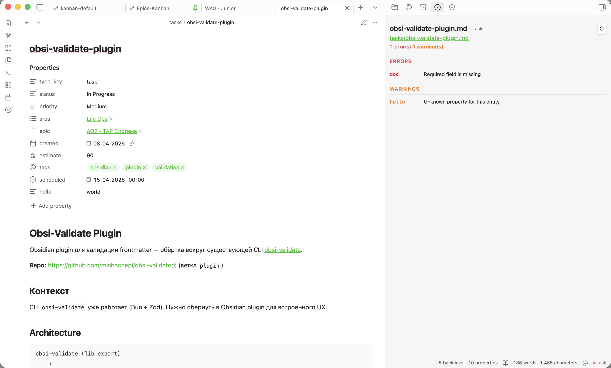

# Obsidian Property Validator

Validate your vault's frontmatter against schemas defined right inside the vault. No external config — your schema lives as YAML frontmatter in special "entity" and "property" files.



It works as an Obsidian plugin, checking notes while you edit, and as a [command-line tool](cli.md)
for git hooks, CI and scripts. Both apply the same rules and give the same verdicts.

## The problem

Obsidian lets you put anything in frontmatter. That's great until your vault grows and you find:

```yaml
# Note A
priority: Medium
# Note B
priority: 10
# Note C
priority: mid
```

Your Dataview queries break. Your templates assume values that don't exist. You spend time hunting down inconsistencies instead of writing.

## How it works

You define two kinds of schema files — regular markdown notes in your vault:

- **Entities** describe note types: "a `task` has fields `status`, `priority`, `project`"
- **Properties** describe field rules: "`status` must be one of `Backlog`, `In Progress`, `Done`"

!!! tip "Think of it like a database"
    An entity is a table definition. A property is a column type. Your notes are rows.

Each note's frontmatter is checked against its entity; the plugin shows the result in the
status bar and the results panel.

See [Schema reference](schema-reference.md) for the full format.

## Key features

- **Live validation** — the status bar and results panel update as you edit
- **Entity inheritance** — extend base entities with more specific types
- **Field rules** — types, allowed values, ranges, required and conditionally required fields, custom JavaScript checks
- **Link checks** — linked notes must exist and can be required to have a type, folder or property; body wikilinks are checked too, resolved the way Obsidian resolves them
- **Schema editor** — create and edit entities and properties from Settings
- **CLI and library** — the same validation in the terminal, in CI, or from code; the schema can also be exported as [mdbase](mdbase.md) JSON Schema

## Quick links

- [Getting started](getting-started.md) — install and create your first schema
- [Configuration](configuration.md) — plugin settings and schema management UI
- [Schema reference](schema-reference.md) — entity/property file format and validation logic
- [CLI](cli.md) — command-line usage
- [Architecture](architecture.md) — data flow, modules, security
- [mdbase engine](mdbase.md) — the CLI's JSON-Schema engine and `mdbase-export`
- [Troubleshooting](troubleshooting.md) — common problems
