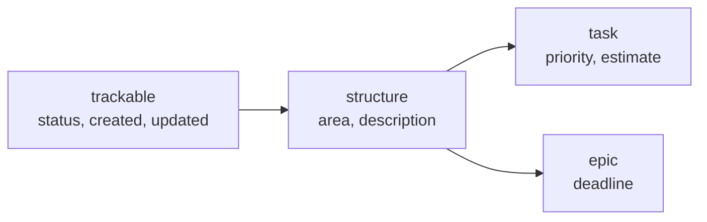

# Schema reference

The schema lives in your vault as two kinds of notes:

- **Entities** describe note types: which frontmatter fields a note of that type has.
- **Properties** describe fields: what a valid value is.

!!! tip "Think of it like a database"
    An entity is a table definition. A property is a column type. Your notes are rows.

---

## Directory structure

```
{schema_dir}/
  entities/
    task_entity.md
    structure/           # subfolders group items in the settings UI
      area_entity.md
    _deprecated/         # archived definitions — not part of the schema
  properties/
    status_property.md
    priority_property.md
    _deprecated/
```

Every markdown file under `entities/` that has `entity_name` in its frontmatter is an entity;
every file under `properties/` with `property_name` is a property. The `_entity.md` /
`_property.md` suffix is a naming convention (the settings UI uses it for new files).

Not loaded: anything under `_deprecated/` (where the **Archive** action moves retired
definitions), `_archive/`, `_skill/` or a dot-folder, and `_index.md` files. Notes of an
archived type fail with `Unknown entity type`.

---

## Entity files

```yaml
---
entity_name: task
extends: structure
allow_extra: false
expected_folder: tasks/
property_patterns: ['^time_[a-z]+$']
properties:
  status: { required: true }
  estimate: {}
  dod:
    required_unless:
      status: [Closed, Rejected]
---
```

| Field | Type | Default | Description |
|-------|------|---------|-------------|
| `entity_name` | string | — | The type name notes use in their type field. Required. |
| `properties` | map | `{}` | The note's fields and their per-entity rules (below). |
| `extends` | string | — | Parent entity; its properties are inherited. |
| `allow_extra` | boolean | `false` | Fields not listed produce no warning. Not inherited. |
| `expected_folder` | string | — | Notes of this type must be inside this folder (vault-relative). |
| `property_patterns` | list of regex | — | Field names matching any pattern count as known (for generated keys like `time_<area>`). Values are not checked. Inherited. An invalid regex stops the schema from loading. |

### Properties block

```yaml
properties:
  status: { required: true }   # the note must have this field
  priority: {}                 # optional
  dod:
    required_unless:           # required, except when status is Closed or Rejected
      status: [Closed, Rejected]
```

| Key | Description |
|-----|-------------|
| `required` | The field must be present. |
| `required_unless` | Map of field → values. The field is required unless ANY listed field holds ANY of its values. Declaring it implies `required: true`; `required: false` turns the rule off. The condition field must hold a single value (a list never matches), numbers match their text (`1` matches `"1"`), and matching is exact (`Closed` ≠ `closed`). A malformed block stops the schema from loading. |

A field listed here without a property note is known but has no value check. When a property
note with the same name exists, its rules apply.

### Inheritance



`task` gets all 7 properties: 2 own, 2 from `structure`, 3 from `trackable`. A child's config
for a property replaces the parent's. Circular inheritance stops the schema from loading
(`Circular entity inheritance: a → b → a`); `extends` naming a missing entity is ignored.

---

## Property files

```yaml
---
property_name: status
property_type: enum
allowed_values:
  - Backlog
  - In Progress
  - Done
---
```

| Field | Type | Applies to | Description |
|-------|------|-----------|-------------|
| `property_name` | string | all | Field name. Required. |
| `property_type` | string | all | Value type (below). Default `string`; an unknown type means no value check. |
| `allowed_values` | list | enum | Allowed values. Numbers compare as text. Without values any text passes. |
| `min_value`, `max_value` | number | number | Inclusive bounds. |
| `unit` | string | number | Informational. |
| `nullable` | boolean | all | An empty value counts as filled in, so a required field may be left empty. |
| `custom_validator` | string | all | JavaScript expression (below). |
| `target_type_key`, `target_folder`, `target_has_property`, `target_property_value` | | link, links, list | Link constraints (below). |
| `etl.value_map` | map | all | Words that stand for values, e.g. `{good: 8}` for a number. Inline `[key:: good]` values are mapped before checking. |

---

## Empty values and coercion

Values are read the way mdbase reads them, so the format is no stricter than mdbase:

- **Empty is not set.** A field with no value (`status:`), `null` or `""` is treated as
  absent: an optional field passes, a required one fails with `Required field is missing`
  (unless the property is `nullable`). No other check runs on an empty value.
- **Values are coerced** when the intent is clear: a number, `true`/`false` or a date counts
  as text; numeric text (`"90"`) counts as a number; `"true"`/`"false"` in any case count as
  booleans. Anything else is checked as written.

---

## Value types

| Type | Valid value |
|------|-------------|
| `string` | Text (numbers, booleans and dates count as text). |
| `number` | A number or numeric text, within `min_value` / `max_value`. |
| `boolean` | `true` or `false`, also as text in any case. |
| `date`, `datetime`, `time` | Text or a YAML date; the format is not checked. |
| `enum` | One of `allowed_values`, compared as text. |
| `link` | Text (the wikilink syntax itself is not checked). |
| `links` | Text or a list of text. |
| `list` | A list, or a single text, number or boolean (a one-item list). A mapping or an empty value fails. |
| `emoji` | Text made only of emoji. |
| `any` | Anything — for fields whose shape varies by note. |

---

## Link constraints

For `link`, `links` and `list` properties: rules for the notes the field links to. Each value
of the field is checked (a single link or every item of a list).

```yaml
---
property_name: owner
property_type: link
target_type_key: person      # or a list: [area, project]
target_folder: People/
target_has_property: email
target_property_value: { property: status, value: Active }
---
```

| Constraint | The linked note must… |
|------------|-----------------------|
| *(always)* | exist — otherwise `Linked note "X" not found in vault` |
| `target_type_key` | have one of these types |
| `target_folder` | have a vault path starting with this folder |
| `target_has_property` | have this frontmatter field |
| `target_property_value` | have this field equal to this value (compared as text) |

The plugin checks link constraints whenever the schema has any. The CLI checks them only with
`--check-links`.

### How links resolve

Resolution follows Obsidian's:

- `[[Name|Alias]]`, `[[Name#Heading]]` and `![[Name]]` all point to `Name`.
- Case does not matter, `.md` is optional, and a partial path works: `[[b/Note]]` finds
  `a/b/Note.md`. A path that matches no file does not fall back to the bare name.
- Canvases, images and other files are linked with their extension (`[[board.canvas]]`).
- When several files match: a file in the linking note's folder wins, then live files before
  archived ones (`_archive/`, `_skill/`), then fewer folders, then alphabetical order.
- A name in `aliases:` frontmatter resolves only if no file has that name.

---

## Custom validators

A JavaScript expression that sees `value`:

```yaml
custom_validator: "value % 0.5 === 0 ? true : 'Must be a multiple of 0.5'"
```

| Returns | Result |
|---------|--------|
| `false` | Error: `Custom validation failed` |
| a string | Error with that message |
| anything else | Pass |
| throws | Warning: `Custom validator error: …` |

It runs for every non-empty value, after coercion, also when the type check failed.

!!! warning "Security"
    The expression runs unsandboxed with full JavaScript access (in Obsidian: `window`, `app`;
    in the CLI: `process` and Bun APIs). Use only validators you wrote or trust. See
    [Architecture > Security](architecture.md#security).

---

## Validation

### Order of checks

1. **YAML** — frontmatter that does not parse is an error (`_yaml`); nothing else is checked.
2. **Type** — the type field names the note's entity (see below). Entity and property notes are
   skipped.
3. **Expected folder** — the entity's `expected_folder` (error on `__path__`).
4. **Shape** — unknown fields, value types, `required` / `required_unless`.
5. **Custom validators and link constraints.**
6. **Task intake** — the built-in rule below.
7. **Body links** (plugin setting *Check links in the note body*, CLI `--check-links`) —
   wikilinks and inline properties in the note body; warnings, or errors with the CLI's
   `--strict-links`.

### The type field

The field that names a note's type is, in order: the plugin's **Type key field** setting or the
CLI's `--type-key-field` / config `type_key_field`; else `type_key` if the schema declares a
`type_key` property; else `entity`.

| Type field | Result |
|------------|--------|
| a known entity | validated as that entity |
| an unknown name | error `Unknown entity type: …` |
| missing, `null` or `""` | the default type if one is set (with a warning), else skipped with a warning |
| a list or mapping | error `… must be a string` |

### Body links and inline properties

With link checks on, the body is scanned for the items below. Each problem is a warning — a
link to a note not written yet is normal in Obsidian — or an error with `--strict-links`.

- **Wikilinks** — each should resolve (`[[X]] not found in vault`). Links inside HTML
  comments, fenced code blocks and inline code are ignored.
- **Inline properties** `[key:: value]` — the value is mapped through `etl.value_map`, coerced
  to the property's type (lists split on commas) and checked like a frontmatter value; a
  wikilink value should resolve and meet the property's link constraints.

Not checked: markdown links (`[text](path)`), and links in frontmatter fields that have no link
constraints.

### Task intake

A built-in rule for notes of type `task` whose `created` is on or after 2026-08-18 00:00
(UTC+2): `created` must be a full ISO timestamp with time, `created_by` must hold exactly one
link, and `epic` or `area` must be set. Older tasks, and tasks without a readable `created`, are
exempt.

### Errors and warnings

Errors make a note invalid; warnings do not.

| Condition | Result |
|-----------|--------|
| YAML does not parse | :red_circle: Error |
| Type field is a list or mapping | :red_circle: Error |
| Unknown entity type | :red_circle: Error |
| Note outside `expected_folder` | :red_circle: Error |
| Required field missing | :red_circle: Error |
| Wrong value type or out of range | :red_circle: Error |
| Custom validator returned `false` or a message | :red_circle: Error |
| Linked note missing or breaking a link constraint | :red_circle: Error |
| Task-intake rule broken | :red_circle: Error |
| Broken body wikilink or inline property (link checks on) | :yellow_circle: Warning (:red_circle: with `--strict-links`) |
| Unknown field | :yellow_circle: Warning |
| No type field (skipped) | :yellow_circle: Warning |
| Default type used | :yellow_circle: Warning |
| Custom validator threw | :yellow_circle: Warning |

### Vault scan

**Validate vault** checks every markdown note except those under a dot-folder, `_archive/` or
`_skill/`, and `_index.md` files:

- **Valid** — no errors
- **Invalid** — has errors
- **Skipped** — no type and no errors


